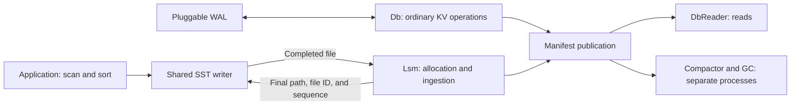

# SlateDB Standalone SST Writing and Ingestion

Table of Contents:

- [Summary](#summary)
- [Motivation](#motivation)
- [Goals](#goals)
- [Non-Goals](#non-goals)
- [Design](#design)
- [Impact Analysis](#impact-analysis)
- [Operations](#operations)
- [Testing](#testing)
- [Rollout](#rollout)
- [Alternatives](#alternatives)
- [Open Questions](#open-questions)
- [References](#references)

Status: Draft

Authors:

* [kumarUjjawal](https://github.com/kumarUjjawal)

## Summary

This RFC adds a standalone SST writer and reader, and a bulk-load client called
`Lsm`. For a bulk load, the application closes `Db` and opens `Lsm`. `Lsm`
assigns each file a path, an ID, and a sequence number. The application supplies
sorted rows, and the writer stores that sequence number in every row.

`Lsm` publishes a batch of completed files in one manifest update. Each file is
built at its final path, so nothing is copied. The SST and manifest formats stay
the same. `Lsm` has no reads and starts no compactor. Applications can read
published files through `DbReader` during the load. After the load, the
application closes `Lsm` and reopens `Db` for ordinary writes. Only one of them
writes to a database at a time.

## Motivation

[Issue #1143](https://github.com/slatedb/slatedb/issues/1143) requests SST creation
outside a running database. The applications in
[issue #1105](https://github.com/slatedb/slatedb/issues/1105) accumulate updates
in vectors or bitmaps. They can write them as SSTs at flush time and let
SlateDB manage those files.

Bulk loads are one example. An
[Iceberg primary-key index](https://github.com/slatedb/slatedb/pull/2103#issuecomment-5789501302)
builds through `Db` with the WAL off, then takes ordinary writes with the WAL
on. Writes stall when L0 fills. Compaction accounted for 33% of process CPU
samples during the initial load and 54% during a rebuild
([#2148](https://github.com/slatedb/slatedb/issues/2148)), although almost
every key had one version. Writing SSTs directly skips the memtable flush. The
application still has to sort its keys.

This index can use a separate database for each table, so a bulk load pauses
writes only for that table
([per-table handoff](https://github.com/slatedb/slatedb/pull/2103#issuecomment-5800449727)).

This proposal builds on [RFC #1146](https://github.com/slatedb/slatedb/pull/1146),
by [KarinaMilet](https://github.com/KarinaMilet), with shared SST interfaces and
a SlateDB ingestion protocol.

## Goals

- Expose standalone SST creation and reading.
- Expose SST ingestion independently of ordinary KV writes.
- Define exclusive writer ownership, publication, and handoff to `Db`.
- Preserve sequence ordering, recovery, and file cleanup guarantees.
- Publish many files atomically in one manifest update.
- Measure manifest growth and the complete bulk-loading cost.

## Non-Goals

- Add ingestion to `Db` or run `Db` and `Lsm` writers concurrently on one database.
- Define custom KV provider traits or coordinate their unpublished memory reads.
- Add a general external sorter, foreign formats, or custom comparators.
- Import source database histories.
- Provide durable request deduplication or automatic resume of a failed load.

## Design

### Component Boundary

`Db` handles ordinary KV operations, memtables, transactions, and the WAL. `Lsm`
handles file allocation and publication. It has no reads, and it starts no
compactor or garbage collector. `Db` and `Lsm` publish to the same manifest and
follow the same writer fencing protocol.

Applications read published data through `DbReader`, also while `Lsm` runs.
While `Lsm` runs, a compactor and a garbage collector can run as separate
processes, through `CompactorBuilder` and `GarbageCollectorBuilder`, or through
`Admin::run_compactor` and `Admin::run_gc`.

`Db`, `Lsm`, and `Compactor` share the code that reads and writes SST files.
Today, the `Db` memtable flush and the compactor build files with the same
internal writer, `TableStore::table_writer`. `SstWriter` is the public form of
that writer. `Db` and the compactor also use internal writer operations that the
public API leaves out. The compactor uses the block size returned by the
internal writer to decide when to start a new file. A `Db` flush can cancel a
close in progress. This is the same split as `Reader`, which `Db` and `DbReader`
share. Each client keeps its own ID allocation, segment split, upload limits,
sequence rules, and manifest publication.

Together with the pluggable WAL, this lets an application provide its own write
frontend while SlateDB manages the LSM. The application still handles reads and
recovery for data it hasn't published.



Shared SST reading and writing live in `slatedb-sst`; client coordination
remains in `slatedb`.

### SST Interfaces

```rust
pub enum SstSequence {
    FromRows,
    Fixed(u64),
}

pub struct SstArtifact {
    handle: SsTableHandle,
    path: Path,
    encoded_size: u64,
    row_count: u64,
    sequences: RangeInclusive<u64>,
}

impl SstArtifact {
    pub fn handle(&self) -> &SsTableHandle;
    pub fn path(&self) -> &Path;
    pub fn encoded_size(&self) -> u64;
    pub fn row_count(&self) -> u64;
    pub fn sequences(&self) -> &RangeInclusive<u64>;
}

impl SstWriter {
    pub fn new(
        store: Arc<dyn ObjectStore>,
        path: Path,
        id: Ulid,
        options: SstWriterOptions,
    ) -> Result<Self, Error>;

    pub async fn add(&mut self, entry: RowEntry) -> Result<(), Error>;
    pub async fn close(self) -> Result<SstArtifact, Error>;
}

impl SstReader {
    pub fn new_with_options(
        store: Arc<dyn ObjectStore>,
        options: SstReaderOptions,
    ) -> Self;

    pub async fn open_at(&self, path: Path) -> Result<SstFile, Error>;
}
```

Each writer produces one file. Options select the format version, compression,
filters, block transformation, and sequence:

| Sequence | Row contract | Use |
| --- | --- | --- |
| `FromRows` | Each row keeps its sequence. A key can have many versions. | Standalone creation and inspection |
| `Fixed(s)` | The writer stores `s` in every row and ignores the sequence in each `RowEntry`. One value, merge operand, or tombstone per key. | `Lsm::new_sst_writer` |

In both cases, rows keep their `create_ts` and `expire_ts`. Keys ascend in byte
order, with versions in descending sequence order. The writer rejects unordered
entries, duplicate key-sequence pairs, empty files, and records outside the
format limits before passing them to the builder. With `Fixed(s)`, a repeated
key is a duplicate key-sequence pair.

When `close()` succeeds, the file is uploaded and the caller gets an
`SstArtifact` with the fields shown above. Its handle includes the file ID, key
bounds, and format metadata. `sequences` holds the lowest and highest sequence
in the file. For a `Fixed(s)` file, both are `s`. If upload fails, the writer
attempts to abort it and returns no artifact.

The artifact can stay in memory. An application can save its metadata if a
standalone tool needs it, but the API doesn't require a JSON file or a
serialization format. The artifact describes the completed file; the manifest
records whether it was published.

Standalone tools can use `SstWriter::new` with an explicit path and physical ID.
The caller owns the upload and cleanup and must keep the completed file
immutable. For ingestion into `Lsm`, the application uses `Lsm::new_sst_writer`,
which supplies the path, ID, sequence, and configuration.

A standalone reader opens an SST with `SstReader::open_at(path)`, where `path`
is the full path of the `.sst` object, so it does not need a database root. If
the file name is `{ULID}.sst`, the reader uses that ULID as the file ID, which
the cache also uses. For other names, it uses a fresh ID. The public
`SstReader::new`, `open(id)`, and `open_with_handle` stay unchanged.

A standalone reader takes the block transformer that wrote the file through
`SstReaderOptions`, and an optional block cache.

Readers sharing a cache scope need to agree on which file each ID refers to and
how to decode it. Writes use the final file ID when caching is enabled.

### Producing Sorted Files

The application sorts its input before it adds rows to `SstWriter`, and it owns
any temporary storage for the sort.

A file for `Lsm::ingest` holds at most one entry per key. If files overlap,
publication order decides which put or delete a reader sees. A merge operand in
an ingested file combines with older values, the same as a merge from `Db`. To
keep several merge operands for one key, the application writes them to separate
files and publishes those files in order. `Lsm` takes no merge operator, so the
application must configure the same merge operator on every reader, compactor,
and later `Db` that processes those rows. Without it, reads and compaction of
those keys fail.

### Lsm API

```rust
pub enum IngestSequence {
    Allocate,
    Explicit(u64),
}

impl Lsm {
    pub fn builder(path: Path, store: Arc<dyn ObjectStore>) -> LsmBuilder;

    pub async fn new_sst_writer(
        &self,
        sequence: IngestSequence,
    ) -> Result<SstWriter, Error>;

    pub async fn ingest(&self, artifacts: Vec<SstArtifact>) -> Result<(), Error>;

    pub async fn close(&self) -> Result<(), Error>;
}
```

Configure the object store, block transformer, file format, segment extractor,
WAL, and system clock on the `Lsm` builder. The builder takes no block cache,
merge operator, or compaction settings, because `Lsm` does not read or compact.
Files use the client's store, transformer, and format configuration, with no
per-import override.

The WAL configuration selects the WAL store or custom `WriterInit` used for
fencing and recovery checks when switching from `Db`. Imports don't append WAL
records.

`Lsm::new_sst_writer` returns an `SstWriter` with the final path, file ID, and
sequence `s`, in `Fixed(s)` mode. The application adds sorted records, closes
the writer, and passes the artifact to `ingest`, alone or in a batch with other
artifacts. It requests writers in publication order. Files can build and upload
in parallel.

With `Allocate`, `Lsm` assigns the next sequence number. `Explicit` works like
`WriteOptions::seqnum`. The caller supplies a sequence above every sequence that
`Lsm` gave out or published. It also keeps those values ordered across imports
and later `Db` writes. `Lsm` reserves the sequence when it creates the writer,
so sequences rise in allocation order, and publication order decides which
record wins when files overlap. If the application drops a writer, its sequence
stays unused. That gap is safe, because `WriteOptions::seqnum` can also skip
sequences. The SST ID in the artifact is useful for diagnostics, but compaction
can replace and collect the object it identifies.

Rows keep the `create_ts` and `expire_ts` that the application sets in each
`RowEntry`. A row without `expire_ts` does not expire, even if the database has
a default TTL. `Db` applies the default TTL only when it writes a row.
A writer from `Lsm` rejects a row with a `create_ts` above the current time of
the `Lsm` clock. `Db` starts its clock at `last_l0_clock_tick`, so a future
value can make `Db` writes fail after the handoff. Compaction also uses
`last_l0_clock_tick` as its clock, so a future value can expire rows too early.
Filters must handle missing timestamps, and `KeyValue` continues to return zero
for a missing creation time.

### Ingestion and Publication

`SstWriter` checks the records, writes block checksums, and uploads the file to
its final path. We rely on upload success and supported transport checksums
instead of reading the whole file back.

`ingest` takes a batch of one or more artifacts. When a writer from `Lsm`
closes, `Lsm` records the handle of the completed file. For each artifact,
`ingest` finds that record by the file ID and publishes the recorded handle. It
rejects an artifact without a record, such as one from a standalone writer. This
holds even when the ID, path, sequence, and format match a pending file. There
is no copy or second record scan. It does not wait for L0 space, because `Db` is
closed and `Lsm` starts no compactor, so a wait can block forever. L0 can grow
past `l0_max_ssts`, which adds manifest views and L0 reads for `DbReader`. A
reader can avoid those reads with a checkpoint from before the load.

`Lsm` follows [RFC 0029](0029-gc-safe-sst-ulid-timestamps.md): it allocates each
final SST ID before construction, and the physical ID and initial view ID match.
Their timestamps must meet the current L0 cutoff and never go backwards in
allocation order. Equal timestamp milliseconds are allowed.

`Lsm` publishes files in allocation order, even when uploads finish out of
order. Suppose that it allocates A, B, and C. A batch that contains B and C
waits until A publishes or the application abandons A. A batch that contains A
and C skips B, so `ingest` rejects it unless the application already abandoned
B. An abandoned file can never publish. This order keeps unfinished files safe
from garbage collection without recording pending imports in the manifest.

One manifest update publishes the views of all files in the batch, or none of
them. It advances `last_l0_seq` to the highest sequence in the batch. It
advances `last_l0_clock_tick` to the current time of the `Lsm` clock, which is
not below any `create_ts` in the batch. It records the sequence/time sample, and
sets `recent_snapshot_min_seq` to the new `last_l0_seq`. A `Db` flush does the
same when it has no active snapshots, and `Lsm` has no snapshots. Imports leave
the WAL replay position where it was when `Lsm` opened. Imports advance
committed and durable progress after the manifest update succeeds, without
advancing WAL progress or waiting for a nonexistent WAL record. Success means
that the files and their publication are durable.

### Segments

In a segmented database, each SST belongs to one segment. The writer checks key
order and records the first and last keys in `SsTableInfo`. Those keys must have
the same valid segment prefix. The extractor's prefix contract ensures that,
for sorted keys, the keys in between belong to that segment too.

That lets `ingest` choose the segment from the file metadata without reading all
the records again. It rejects missing bounds, mixed prefixes, or conflicting
prefixes, then publishes valid files into the segment's L0 tree using the
existing prefix-conflict checks. An unsegmented database uses its root tree.

### Switching Between Lsm and Db

A handoff transfers exclusive writer ownership and preserves the published
sequence and clock. Applications stop operations using the departing client and
finish active transactions before closing it. `Db` must close with a successful
`FlushType::MemTable` flush so the files cover its accepted writes. A WAL-only
flush is insufficient.

Before it accepts imports, `Lsm` uses the existing `WriterFencer` and configured
`WriterInit::fence_and_init` to fence both manifest and WAL writers. It consumes
the returned bounded replay iterator, ignoring rows already covered by
`last_l0_seq`. If any row has a higher sequence, opening fails and the
application must recover and flush through `Db` first. Otherwise, an import
can advance the published sequence past WAL writes that still need replay.
Iterator errors also abort startup.

Startup closes the returned WAL writer without appending imported rows,
including when replay validation fails. If replay validation or WAL close fails,
`Lsm` returns an error. Before it accepts imports, `Lsm` checks that it still
owns the manifest. The monotonic clock starts from `last_l0_clock_tick` using
the configured system clock. This reuses the existing WAL recovery boundary
without a separate handoff record.

Before closing `Lsm`, the application stops producing records. `Lsm::close`
stops accepting work, cancels unfinished file work, and settles publication
already in progress before releasing ownership. The next `Db` reads the latest
manifest and starts above the last imported sequence. `Db` can reuse the
sequences of dropped writers. That is safe, because their files never publish.

Before `Db` opens, the application can compact the ingested files.
`CompactionRequest::Full` leaves L0 out, so this needs a running compactor. The
compactor can choose the files, or run a `CompactionRequest::Spec` request that
names them. With `enable_trivial_move`, files whose key ranges do not overlap
move into sorted runs without a rewrite. If `Db` opens while L0 is at
`l0_max_ssts`, its flushes wait until a compactor drains L0.

If close or publication has an uncertain outcome, the next client still has to
fence older writers and perform the recovery checks.

### Read Visibility

`Lsm` appends no WAL records for imported rows, so while it runs, a `DbReader`
only follows the manifest. The default WAL writes one empty WAL file when `Lsm`
fences the old writer. A reader sees an import after its next manifest poll.
[#2186](https://github.com/slatedb/slatedb/pull/2186) proposes a refresh on
demand, so that a reader can see an import as soon as `ingest` returns. A reader
pinned to an earlier checkpoint keeps its old manifest.

One race remains after `Db` opens again. In each poll, a `DbReader` loads the
latest manifest and then lists new WAL files. Suppose that the reader loads the
manifest with write 100. Before it lists the WAL, `Lsm` publishes import 101 and
closes, and `Db` opens and writes 102. The reader then replays 102 on top of the
manifest with 100. Until its next poll, it exposes 102 without 101. Sequence
gaps cannot show the missing import, because ordinary writes can supply
explicit sequences.

To prevent this, the reader lists the WAL first, then loads the latest manifest,
and replays only the WAL files in its list. If the list includes 102, the
manifest load comes after the write of 102, so the manifest includes 101. The
reader advances its durable sequence only after it installs the new state.
Initial open uses the same order. Pinned readers keep their fixed manifest and
replay boundary. This needs a strongly consistent manifest read, and a WAL
replay that stops at a given WAL file.

### Failures and Retries

If construction or upload fails, nothing is published. Before publication
starts, dropping the writer or an unused artifact abandons the file. If
`ingest` rejects a batch before publication starts, every file in the batch is
abandoned. `Lsm` can then publish later files, but it will reject an abandoned
file. We try to abort unfinished uploads, and GC handles anything left behind
under the existing age and cutoff rules.

`Lsm` retains the highest sequence `s` of the batch, the file IDs, the writer
epoch, and the exact candidate update for manifest version `m`. Later imports
remain blocked until publication resolves. After a lost write response, it
refreshes through the fenced manifest interface. If it still owns the epoch,
`last_l0_seq >= s` proves that the whole batch published. `s` exceeds the
previous frontier, and the batch publishes in one update.

Each manifest version is a conditional create at the next ID. If the frontier
remains below `s` and `m` is absent, `Lsm` retries the same update at `m`.
Once `m` exists, a delayed write cannot replace it. A refresh then distinguishes
the import from a competing metadata update. If the competing update won, `Lsm`
reapplies the import to the latest manifest under the same writer epoch.
All retries retain the metadata GC boundary checks that reject obsolete versions.

If reads or writes remain uncertain, or another writer fences the client,
`Lsm` stops accepting imports and reports unresolved publication. Cancelling
the call doesn't let later imports pass an unresolved publication.

After a restart, published data comes from the manifest. The application owns
its unpublished input, sorting scratch, and load progress. A new `Lsm` does not
resume unfinished uploads or publish files that the old client left
unreferenced.

There is no request ID or status lookup, so after a lost response the application
has to reconcile its progress before retrying. Publishing the same data again
at a new sequence can overwrite imports made in between. Another writer
advancing the frontier doesn't identify the earlier request. Having the SST
object or its saved metadata doesn't tell us whether publication succeeded.
Neither proves that an old, unreferenced file is safe to publish under the
current GC cutoff.

The application knows the sequences of its files before publication. After it
opens a new `Lsm`, which fences the old one, it reads the latest manifest with
`Admin::read_manifest`. Suppose that the application controls every writer, and
no other client wrote since the lost response. Then a `last_l0_seq` at or above
the highest sequence of the batch shows that the batch published. A lower value
shows that it did not. If another client wrote, and the application has no other
evidence, the outcome stays unknown.

## Impact Analysis

### Core API & Query Semantics

- [ ] Basic KV API (`get`/`put`/`delete`)
- [ ] Range queries, iterators, seek semantics
- [ ] Range deletions
- [x] Error model, API errors

### Consistency, Isolation, and Multi-Versioning

- [x] Transactions - active `Db` operations finish before handoff to `Lsm`.
- [x] Snapshots
- [x] Sequence numbers

### Time, Retention, and Derived State

- [x] Logical clocks
- [x] Time to live (TTL)
- [x] Compaction filters
- [x] Merge operator
- [x] Change Data Capture (CDC)

### Metadata, Coordination, and Lifecycles

- [ ] Manifest format - ingested files use the existing format.
- [x] Checkpoints
- [ ] Clones
- [x] Garbage collection
- [ ] Database splitting and merging
- [x] Multi-writer - `Db` and `Lsm` share writer fencing.

### Compaction

- [ ] Compaction state persistence
- [ ] Compaction filters
- [x] Compaction strategies - L0 can grow past `l0_max_ssts` during a load.
- [ ] Distributed compaction
- [ ] Compactions format

### Storage Engine Internals

- [x] Write-ahead log (WAL)
- [x] Block cache
- [ ] Object store cache
- [x] Indexing (bloom filters, metadata)
- [ ] SST format or block format - physical layout is unchanged.

### Ecosystem & Operations

- [ ] CLI tools
- [x] Language bindings (Go/Python/etc) - new bindings are follow-up work.
- [x] Observability (metrics/logging/tracing)

## Operations

### Performance & Cost

Ingested files add no manifest fields. Each file adds one L0 view, the same as
a `Db` flush. Measure manifests with 1,000, 10,000, and 100,000 L0 views, with
realistic key bounds, segments, and retained checkpoints. Report encoded size,
encode and decode time, decoded memory, and the traffic of repeated full
manifest uploads.

Building an SST of `S` bytes through `Lsm` uploads those bytes once. Ingestion
then adds one successful manifest update for each batch, without downloading,
uploading, or scanning the file again. That count excludes opening and fencing,
concurrent compaction, multipart requests, and retries. Manifest reads and
object listings during open, recovery, and GC also add requests.

Manifest publication stays ordered while file construction and uploads can
overlap. Benchmark file sizes, batch sizes, and construction concurrency to see
whether upload, publication, or compaction limits throughput. Measure peak
memory and concurrent uploads alongside throughput.

Measure how long ordinary writes stop, from closing `Db` until it reopens after
publication. Include file construction and upload. Use that duration to compare
this design with staging files before the handoff.

Compare the complete pipeline with normal batch writes: sorting and spill, SST
construction, index/filter buffers, upload, validation, publication, and
compaction. Ingested L0 files still need compaction, unless trivial moves apply.

### Observability

Track bytes built and imported, batch sizes, L0 file counts, file build and
publication time, failures, uncertain outcomes, and manifest size.
Expose the published sequence and clock along with handoff failures and errors
that require recovery. Object and manifest IDs help with diagnostics, but they
aren't retry tokens.

### Compatibility

Keep existing `SstReader`, `SstFile`, `SstIndex`, `RowEntry`, `ValueDeletable`,
`SstStats`, and `BlockStats` paths through re-exports with unchanged type identity.
Share the SST handle, ID, info, type, and filter-format types without circular
dependencies. Move `CompressionCodec` with the file code while preserving
`slatedb::config::CompressionCodec` and forwarding existing compression features.
Expose the handle's format version through an accessor.

The manifest, `.compactions`, SST, and WAL formats do not change. Ingested files
look like flushed L0 files, so reads, compaction, trivial moves, checkpoints,
clones, and projections need no change. Older readers, compactors, and garbage
collectors can read a database after an import. Upgrade every `DbReader` that
follows the WAL before the first import, so that it uses the WAL-first order
from Read Visibility. A downgrade needs no extra steps for the files. But an old
`DbReader` that follows the WAL can again show write 102 before import 101 if it
runs across a later handoff. So after a downgrade, do not run a handoff while
such readers run.

Block transformation must remain compatible across clients and compactors for
the file's lifetime. Imported changes bypass WAL-based CDC, so consumers of that
WAL need an application notification or resnapshot. Existing binding APIs remain
unchanged. New writer and `Lsm` bindings are follow-up work.

## Testing

- SST contracts: Round-trip `FromRows` and `Fixed(s)` files and standalone
  paths, including versions, timestamps, merges, tombstones, compression,
  transformers, stats, and sequence ranges. Check that invalid ordering,
  repeated keys in `Fixed(s)` files, and format violations are rejected before
  reaching the builder. Merge effects must survive ordered ingested files and
  later `Db` writes. Reject a `create_ts` above the `Lsm` clock. Read and
  compact merge operands with and without the merge operator.
- Direct construction: Check that `Lsm` assigns the final path, ID, and sequence
  before writing and uploads each file once. Finish uploads out of order and
  verify that publication stays in allocation order. Abandon an earlier file
  before ingestion and verify that later files can progress without publishing
  the abandoned ID. Check that artifacts match the issued physical IDs and
  file configuration. Reject an artifact from a standalone writer that copies
  the ID, path, sequence, and format of a pending file. Segment routing must
  use the completed key bounds without scanning records at publication time.
- Batches: Publish a batch in one manifest update, across segments. Reject an
  empty batch, a batch out of allocation order, and a batch with a gap that is
  not an abandoned file. A rejected batch abandons its files.
- Load order: Ingest past `l0_max_ssts` and `l0_max_ssts_per_key`. Compact with
  and without trivial moves, and with a `Spec` request. Open `Db` before and
  after compaction, and measure the flush stall.
- Publication and reads: Import 101 over earlier data while retaining an older
  checkpoint. Read through `DbReader` with get, scan, projections, and restart.
  Trivial moves and rewrites must keep the sequences of ingested rows.
- Handoff: Close `Db` with write 100 published, import 101 through `Lsm`, then
  reopen `Db` and write 102. Run the whole handoff between the manifest load and
  the WAL listing of a `DbReader` poll, and include explicit sequence gaps.
- Recovery and fencing: Test failed `Db` close, configured WAL stores and custom
  `WriterInit`, replay exhaustion and errors, WAL-writer close failures, and
  competing clients. WAL rows beyond file coverage must prevent `Lsm` from
  opening. Check that merge behavior and clocks remain consistent across the
  handoff.
- Failure boundaries: Fail or cancel construction, upload, and manifest
  publication. After a lost response, retry the identical update at the same
  manifest ID, including a delayed original write and a competing metadata
  update. Keep epoch fencing and metadata GC boundary checks in place. Another
  writer publishing 102 must not count as proof that an import at 101
  succeeded. After a lost response and a fence, read the manifest. Under
  exclusive control, it must show the real outcome of the batch. After another
  writer publishes, the outcome must stay unknown. Test writer and artifact
  cleanup, recovery of published state after restart, and GC during uploads
  that outlast the minimum file age.
- Segments: Route files belonging to one segment and reject missing bounds,
  mixed prefixes, and conflicting prefixes. Unrelated segments must stay intact.
- Compatibility: Test that older readers, compactors, and garbage collectors
  read a database after an import. Include imports without `expire_ts` under a
  configured default TTL, dropped writers that leave sequence gaps, optional
  reader roots and caches, and unchanged public exports. Open files by full path
  with a `{ULID}.sst` name and with another name, and keep `open(id)` working
  with a database root.
- Simulation and cost: Combine construction, ingestion, compaction, GC, fencing,
  and restart in the existing simulation framework. Run the metadata and
  end-to-end experiments described above.

## Rollout

1. Measure manifest growth and establish a bulk-load baseline, including sorting and compaction.
2. Extract shared SST code with compatible exports, then expose the standalone writer and reader paths.
3. Change `DbReader` to list the WAL before it loads the manifest. This ships before the first import.
4. Add `Lsm` file allocation, direct SST construction, and ingestion, including exclusive fencing and handling of uncertain outcomes.
5. Validate the `Db` handoff, the `DbReader` WAL order, and segment routing.

The standalone interfaces can ship on their own.

## Alternatives

### Ingestion Through Db

A mixed API supports imports while ordinary writes continue in the same database,
but requires coordination with memory, transactions, WAL progress, and publication.
An application with one database for each table can switch clients instead.
Mixed ingestion remains a future extension if a workload requires concurrent
write modes within one database.

### Normal Batch Writes or Writer-Only Release

Normal batch writes keep the existing lifecycle and don't require the
application to sort its input. They remain the performance baseline because
externally built files still enter L0. A writer-only release helps standalone
file tools, but applications still need `Lsm` to publish files into a
database.

### Stage Files Before Handoff

An application could build SSTs outside managed directories while `Db` keeps
receiving writes, then switch to `Lsm` to import them. That can shorten the write
pause, but it needs a way to validate and install those files safely under GC.
Writes that `Db` takes while the files are built get lower sequences than the
import, so the import overwrites them, even when they are newer.
This stays outside the first release; we can revisit it if a workload needs a
shorter write pause.

If a future staged mode copies files, a storage-side COPY could avoid sending
the bytes through the client. Validation and copying must refer to the same
source version. This RFC builds files directly under `Lsm`, so neither copy
path is needed.

### Durable Request Tracking

One option is to record each request and its result in the manifest. A caller
can then check whether an import succeeded before retrying. The records grow the
manifest and need a retention limit. If SlateDB stores them elsewhere, it must
still record the result atomically with publication. The first API documents
uncertain outcomes without promising durable deduplication.

### Sequence Offsets in the Manifest

[RFC #1146](https://github.com/slatedb/slatedb/pull/1146#discussion_r2649854164)
proposes an offset in the manifest view. The file keeps its own sequences, and
readers add the offset when they read. So a file does not depend on the
database, and a tool can build it before `Lsm` opens. The cost is a new view
field, the offset in every read and compaction, and offsets that stay in sorted
runs after trivial moves. Each release must read data from the next release
([#2289](https://github.com/slatedb/slatedb/pull/2289)). So a new manifest
version needs one release that reads it before a release that writes it. This
RFC builds every file under `Lsm`, so a sequence from `new_sst_writer` has no
such cost. A later mode that ingests files built outside `Lsm` can add offsets.

Rewriting each file during ingestion also puts the destination sequence into
the rows, but it decodes and encodes every record.

## Open Questions

1. Does the first `Lsm` release support segmented databases, or does segment support come later?
2. What manifest growth is acceptable for a large load?
3. Which bulk loads need to look up an import by request ID after a restart?

## References

- [Issue #1143](https://github.com/slatedb/slatedb/issues/1143) and [RFC #1146](https://github.com/slatedb/slatedb/pull/1146), by [KarinaMilet](https://github.com/KarinaMilet).
- RFC #1146 requests for the [package boundary](https://github.com/slatedb/slatedb/pull/1146#discussion_r2649290355), [reader paths](https://github.com/slatedb/slatedb/pull/1146#discussion_r2649289303), [returned handle](https://github.com/slatedb/slatedb/pull/1146#discussion_r2674413603), and [SlateDB manifest representation](https://github.com/slatedb/slatedb/pull/1146#discussion_r2674447687).
- RFC #2103 discussions of the [Lsm client](https://github.com/slatedb/slatedb/pull/2103#pullrequestreview-5286827487), [retry guarantees](https://github.com/slatedb/slatedb/pull/2103#discussion_r4078981105), [shared configuration](https://github.com/slatedb/slatedb/pull/2103#discussion_r4079040923), [building SSTs without copying](https://github.com/slatedb/slatedb/pull/2103#discussion_r4202127474), [sorting in the application](https://github.com/slatedb/slatedb/pull/2103#discussion_r4204482400), and [routing from key bounds](https://github.com/slatedb/slatedb/pull/2103#discussion_r4204648367).
- RFC #2103 reviews of the [write-only Lsm](https://github.com/slatedb/slatedb/pull/2103#discussion_r4575091524), [sequences at ingestion](https://github.com/slatedb/slatedb/pull/2103#discussion_r4575091605), [batch ingestion](https://github.com/slatedb/slatedb/pull/2103#discussion_r4575091581), [L0 overrun and trivial moves](https://github.com/slatedb/slatedb/pull/2103#discussion_r4645403774), and [one entry per key](https://github.com/slatedb/slatedb/pull/2103#discussion_r4645441858).
- [Issue #1105](https://github.com/slatedb/slatedb/issues/1105), including [read and freeze coordination](https://github.com/slatedb/slatedb/issues/1105#issuecomment-3666587872).
- [Pluggable WAL](0030-pluggable-wal.md), [sequence tracking](0012-sequence-tracker.md), [checkpoints](0004-checkpoints.md), and [GC-safe SST identifiers](0029-gc-safe-sst-ulid-timestamps.md).
- [Segment-oriented compaction](0024-segment-oriented-compaction.md) and [compaction filters](0017-compaction-filters.md).
- [SST writer](../slatedb/src/tablestore.rs), [standalone reader](../slatedb/src/sst_reader.rs), [DbReader](../slatedb/src/db_reader.rs), and [manifest publication](../slatedb/src/memtable_flusher/manifest_writer.rs).
- [Writer fencing](../slatedb/src/fence.rs), [WAL initialization](../slatedb/src/wal/mod.rs), and [client configuration](../slatedb/src/db/builder.rs).
- [Conditional metadata writes](../slatedb-txn-obj/src/object_store.rs), [metadata GC boundary checks](../slatedb-txn-obj/src/lib.rs), and [manual compaction](../slatedb/src/admin.rs).
