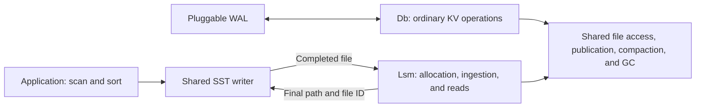

# SlateDB Standalone SST Writing and Ingestion

Table of Contents:

- [Summary](#summary)
- [Motivation](#motivation)
- [Goals](#goals)
- [Non-Goals](#non-goals)
- [Design](#design)
- [Impact Analysis](#impact-analysis)
- [Operations](#operations)
- [Testing](#testing)
- [Rollout](#rollout)
- [Alternatives](#alternatives)
- [Open Questions](#open-questions)
- [References](#references)

Status: Draft

Authors:

* [kumarUjjawal](https://github.com/kumarUjjawal)

## Summary

This RFC adds a standalone `SstWriter` and an `Lsm` client for bulk loading and
reading SSTs. The application builds sorted files without going through `Db`'s
memory write path, then lets SlateDB manage those files and compaction.

For the first ingestion mode, the application opens `Lsm` before building the
files. `Lsm` assigns each file's final path and ID, so ingestion can publish it
without copying it. Destination sequences live in the manifest, with no change
to the physical SST format. Once loading is done, the application closes `Lsm`
and switches to `Db` for ordinary writes. Only one of them can be the active
writer for a database.

## Motivation

[Issue #1143](https://github.com/slatedb/slatedb/issues/1143) requests SST creation
outside a running database. Applications in
[issue #1105](https://github.com/slatedb/slatedb/issues/1105) also accumulate
updates in structures such as vectors or bitmaps and encode them at flush time.
Shared file interfaces let these producers reuse SlateDB's storage layer while
keeping their own memory representation.

An [Iceberg primary-key index](https://github.com/slatedb/slatedb/pull/2103#issuecomment-5789501302)
provides a bulk-loading use case. Initial construction runs without a WAL,
followed by ordinary reads, writes, and deletes for CDC with the WAL enabled.
Snapshot runs fill memory and L0 quickly, then wait for compaction.
External SST construction can avoid the memory write path, but its benefit
also depends on sorting, L0 admission, and compaction throughput.

The index also rebuilds individual tables during CDC. Its owner confirmed that
[separate databases per table are compatible](https://github.com/slatedb/slatedb/pull/2103#issuecomment-5808365694)
and cross-table index transactions are unnecessary. Each table can switch
clients independently, following the
[ingestion-only client proposal](https://github.com/slatedb/slatedb/pull/2103#pullrequestreview-5286827487)
and [per-table handoff](https://github.com/slatedb/slatedb/pull/2103#issuecomment-5800449727).

This proposal builds on [RFC #1146](https://github.com/slatedb/slatedb/pull/1146),
by [KarinaMilet](https://github.com/KarinaMilet), with shared SST interfaces and
a SlateDB ingestion protocol.

## Goals

- Expose standalone SST creation and reading.
- Expose LSM reads and ingestion independently of ordinary KV writes.
- Define exclusive writer ownership, publication, and handoff to `Db`.
- Preserve sequence ordering, recovery, and file cleanup guarantees.
- Measure manifest growth and the complete bulk-loading cost.

## Non-Goals

- Add ingestion to `Db` or run `Db` and `Lsm` writers concurrently on one database.
- Define custom KV provider traits or coordinate their unpublished memory reads.
- Add a general external sorter, foreign formats, or custom comparators.
- Import source database histories or publish multiple files atomically.
- Provide durable request deduplication or automatic rebuild recovery.

## Design

### Component Boundary

`Db` handles ordinary KV operations, memtables, transactions, and the WAL.
`Lsm` handles file allocation, publication, and reads over published data.
The application scans and sorts its input, then feeds those records to the SST
writer. Both clients reuse manifest publication, compaction, and GC, and follow
the same writer fencing protocol. They also use the existing `Reader` for get
and scan execution.

`Db`, `Lsm`, and `Compactor` share the code that reads and writes SST files.
That includes `Db`'s L0 flushes and `Compactor`'s output files. Each client still
keeps its own sequence and publication rules. Normal flushes and compaction
outputs store their sequence numbers in the files and do not use deferred
ingestion.

Together with the pluggable WAL, this lets an application provide its own write
frontend while SlateDB manages the LSM. The application still handles reads and
recovery for data it hasn't published.



For one database path, `Db` and `Lsm` operate at different times. Read-only
consumers can coexist under the visibility rules below. Shared SST reading and
writing live in `slatedb-sst`; client coordination remains in `slatedb`.

### SST Interfaces

The writer reuses the existing streaming SST implementation. Its public surface
includes the following methods:

```rust
pub enum SstSequenceMode {
    Preserve,
    Deferred,
}

pub struct SstArtifact {
    handle: SsTableHandle,
    path: Path,
    encoded_size: u64,
    row_count: u64,
    sequence_mode: SstSequenceMode,
}

impl SstArtifact {
    pub fn handle(&self) -> &SsTableHandle;
    pub fn path(&self) -> &Path;
    pub fn encoded_size(&self) -> u64;
    pub fn row_count(&self) -> u64;
    pub fn sequence_mode(&self) -> &SstSequenceMode;
}

impl SstWriter {
    pub fn new(
        store: Arc<dyn ObjectStore>,
        path: Path,
        id: Ulid,
        options: SstWriterOptions,
    ) -> Result<Self, Error>;

    pub async fn add(&mut self, entry: RowEntry) -> Result<(), Error>;
    pub async fn close(self) -> Result<SstArtifact, Error>;
}

impl SstReader {
    pub fn new_with_options(
        store: Arc<dyn ObjectStore>,
        options: SstReaderOptions,
    ) -> Self;

    pub async fn open_at(&self, path: Path, id: Ulid) -> Result<SstFile, Error>;
}
```

Each writer produces one file. Options select the format version, compression,
filters, block transformation, and sequence mode:

| Mode | Record contract | Use |
| --- | --- | --- |
| Preserve | Supplied sequences and timestamps, including versions and merge operands | Standalone creation and inspection |
| Deferred | Sequence zero, one regular value, merge operand, or tombstone per key, no timestamps | `Lsm::ingest` |

Keys ascend in byte order, with versions in descending sequence order. The writer
rejects unordered entries, duplicate key-sequence pairs, empty files, and records
outside the selected mode or format limits before passing them to the builder.

When `close()` succeeds, the file is uploaded and the caller gets an
`SstArtifact` with the fields shown above. Its handle includes the file ID, key
bounds, and format metadata. If upload fails, the writer attempts to abort it
and returns no artifact.

The artifact can stay in memory. An application can save its metadata if a
standalone tool needs it, but the API doesn't require a JSON file or a
serialization format. The artifact describes the completed file; the manifest
records whether it was published.

Standalone tools can use `SstWriter::new` with an explicit path and physical ID.
The caller owns the upload and cleanup and must keep the completed file
immutable. For ingestion into `Lsm`, the application uses `Lsm::new_sst_writer`,
which supplies the path, ID, and configuration.

A standalone reader opens an SST with `SstReader::open_at(path, id)`, so it does
not need a database root. Callers without artifact metadata use a fresh ID.

`Lsm` supplies the cache for database reads. Standalone readers can share that
cache through `SstReaderOptions` or run without one.

Readers sharing a cache scope need to agree on which file each ID refers to and
how to decode it. Sequence overrides happen after reading cached blocks, and
writes use the final file ID when caching is enabled.

### Producing Sorted Files

`SstWriter` expects sorted records, so the application does the source scanning
and sorting. For unsorted snapshot or rebuild data, it chooses how to sort
within its memory budget and whether to spill to temporary storage. Sorting and
spill policy stay in the application; this RFC doesn't add a sorter to SlateDB.

If a source contains repeated keys, the last source update wins for puts and
deletes. For example, a delete at source version 20 wins over a put at version
10, even if a parallel scan returns the put later. The result must not depend
on which scan finishes first.

Merge operands need more care because keeping only the last operand can lose
earlier updates. The application must preserve their effects in source order
and use a compatible merge operator in `Lsm` and the later `Db`.
It can combine operands if that preserves their meaning. Otherwise, it writes
them to separate files and publishes those files in source order. Each deferred
file still has only one entry per key.

The same ordering requirement applies across files with overlapping keys.
The application allocates and publishes them in source order or removes the
overlap before writing them. Sequence zero won't tell `Lsm` which source update
is newer.

The first mode builds files at paths assigned by `Lsm`. The application can do
the sorting before switching clients, as long as it preserves a consistent
source snapshot and update order. It also owns the temporary storage used for
sorting.

### Lsm API

```rust
pub enum IngestSequence {
    Allocate,
    Explicit(u64),
}

pub struct IngestOptions {
    pub sequence: IngestSequence,
}

pub struct IngestResult {
    pub sequence: u64,
    pub sst_id: Ulid,
}

impl Lsm {
    pub fn builder(path: Path, store: Arc<dyn ObjectStore>) -> LsmBuilder;

    pub async fn new_sst_writer(&self) -> Result<SstWriter, Error>;

    pub async fn ingest(
        &self,
        artifact: SstArtifact,
        options: IngestOptions,
    ) -> Result<IngestResult, Error>;

    pub async fn get_with_options(
        &self, key: &[u8], options: &ReadOptions,
    ) -> Result<Option<Bytes>, Error>;

    pub async fn scan_with_options(
        &self, range: BytesRange, options: &ScanOptions,
    ) -> Result<DbIterator, Error>;

    pub async fn close(&self) -> Result<(), Error>;
}
```

The builder follows the existing SlateDB configuration conventions for file
access, caching, compaction, and the segment extractor. It also takes the
database's WAL configuration, merge operator, and system clock. Files use the
client's store, transformer, and format configuration, with no per-import
override. `Lsm` has no put, write, delete, or transaction methods.

The WAL configuration selects the WAL store or custom `WriterInit` used for
fencing and recovery checks when switching from `Db`. Imports don't append WAL
records. The handoff section describes those checks.

`Lsm::new_sst_writer` returns an `SstWriter` with the final path, file ID, and
deferred record mode. The application adds sorted records, closes the writer,
and passes the artifact to `ingest`. It requests writers in publication order.
Files can build and upload in parallel, but `Lsm` publishes them in the order it
allocated their IDs.

`Allocate` asks the client's oracle for the next sequence. `Explicit` works like
`WriteOptions::seqnum`: the caller supplies a sequence above the current maximum
and keeps those values ordered across imports and later `Db` writes.
Each call accepts one deferred file, and publication order decides which record
wins when files overlap. The returned SST ID is useful for diagnostics, but
compaction can replace and collect the object it identifies.

We're leaving creation and expiration timestamps out of the first release to
keep the initial work focused on bulk loading. They can use overrides in SST
view metadata, just like sequences. Before adding that support, we need to
define when the expiration period starts and how reads, merges, compaction, and
snapshots apply the assigned times.

For now, deferred records don't expire, even if the database has a default TTL,
so there is no per-import TTL option. Compaction doesn't invent timestamps when
rewriting a deferred record. If that record merges with later `Db` records, the
existing merge rules still apply. Filters must handle missing timestamps, and
`KeyValue` continues to return zero for a missing creation time.

### Ingestion and Publication

`Lsm` opens only when published SSTs cover earlier WAL writes, as described in
the handoff section. Otherwise, an import could advance the sequence frontier
past writes that still need replay.

Reads and compaction continue while files are built and ingested. `SstWriter`
checks the records, writes block checksums, and uploads the file to its final
path. We rely on upload success and supported transport checksums instead of
reading the whole file back.

`ingest` uses the file ID to check that the file was built through this `Lsm`
client. It also checks the path, sequence mode, and format. Once L0 has space,
it assigns a sequence and publishes the SST using its handle. There is no copy
or second record scan.

`Lsm` follows [RFC 0029](0029-gc-safe-sst-ulid-timestamps.md): it allocates each
final SST ID before construction, and the physical ID and initial view ID match.
Their timestamps must meet the current L0 cutoff and never go backwards in
allocation order. Equal timestamp milliseconds are allowed.

Publication follows allocation order even when uploads finish out of order.
A later file can proceed once the earlier file is published or is abandoned
before publication starts. An abandoned file cannot be published later. This
keeps unfinished files protected by the existing GC cutoff without adding
durable pending-import metadata.

Once the file is uploaded, one manifest update publishes its view and sequence
override. It advances `last_l0_seq` and the monotonic `last_l0_clock_tick`,
records the sequence/time sample, and updates `recent_snapshot_min_seq` under
the existing retention rules for active read views.
The WAL replay boundary stays at the frontier established before opening `Lsm`.
Imports advance committed and database-durable progress after local read state
is installed, without advancing WAL progress or waiting for a nonexistent WAL
record. Success means the file and publication are durable.

### Segments

In a segmented database, each SST belongs to one segment. The writer checks key
order and records the first and last keys in `SsTableInfo`. Those keys must have
the same valid segment prefix. The extractor's prefix contract ensures that,
for sorted keys, the keys in between belong to that segment too.

That lets `ingest` choose the segment from the file metadata without reading all
the records again. It rejects missing bounds, mixed prefixes, or conflicting
prefixes, then publishes valid files into the segment's L0 tree using the
existing prefix-conflict checks. An unsegmented database uses its root tree.

### Switching Between Lsm and Db

A handoff transfers exclusive writer ownership and preserves the published
sequence and clock. Applications stop operations using the departing client and
finish active transactions before closing it. `Db` must close with a successful
`FlushType::MemTable` flush so the files cover its accepted writes. A WAL-only
flush is insufficient.

Before serving reads or imports, `Lsm` uses the existing `WriterFencer` and
configured `WriterInit::fence_and_init` to fence both manifest and WAL writers.
It consumes the returned bounded replay iterator, ignoring rows already covered
by `last_l0_seq`. If any row has a higher sequence, opening fails and the
application must recover and flush through `Db` first. Iterator errors also
abort startup.

Startup closes the returned WAL writer without appending imported rows, including
when replay validation fails. Opening succeeds only after validation and WAL
close succeed, with manifest ownership rechecked before admission. The monotonic
clock starts from `last_l0_clock_tick` using the configured system clock. This
reuses the existing WAL recovery boundary without a separate handoff record.

Before closing `Lsm`, the application stops producing records. `Lsm::close`
stops accepting work, cancels unfinished file work, and settles publication
already in progress before releasing ownership. The next `Db` reads the latest
manifest and starts above the last imported sequence.

If close or publication has an uncertain outcome, the next client still has to
fence older writers and perform the recovery checks.

### Read Visibility

Each `Lsm` read captures a consistent published view and sequence through shared
read machinery and uses existing read-retention rules to protect its files.
An import at 101 supersedes older records for new reads, while a reader pinned
to an earlier checkpoint retains its old manifest. Existing compaction-filter
limits on snapshot consistency still apply.

A WAL-following `DbReader` can stay open while the application switches clients.
For example, it can still hold the manifest for 100 when `Lsm` publishes 101.
If `Db` then resumes and writes 102, the reader can follow that WAL using its
old manifest and expose 102 before it sees 101. Updating the replay boundary
in the new manifest only helps once the reader loads that manifest.

To avoid that race, the reader first captures a bounded WAL end, then loads a
fresh manifest and replays only through the captured bound. It installs the
combined state before advancing durable progress. Initial open and refresh use
this same order under the existing checkpoint policy. Pinned readers keep their
fixed manifest and replay boundary.

If the captured WAL includes a later `Db` write at 102, the subsequent manifest
read must include import 101. Sequence gaps cannot identify imports because
ordinary writes can supply explicit sequences. This requires a fresh, strongly
consistent manifest read and bounded replay support from the WAL implementation.

### Manifest Representation

Sequence interpretation belongs to the view:

```fbs
table CompactedSsTableView {
    id: Ulid (required);
    sst_id: Ulid (required);
    visible_range: BytesRange;
    sequence_override: ulong = null;
}
```

Absent overrides preserve stored sequences. Populated overrides apply one
sequence before snapshot filtering, version selection, or merge resolution.
Translation occurs above raw caches, while standalone readers expose physical
metadata. Checkpoints, clones, and projections preserve the override while
referencing the original file. Compaction inputs resolve these views from the
manifest.

Compactions that rewrite records materialize effective sequences and omit
overrides from their output views. When `enable_trivial_move` is enabled and
effective key ranges are disjoint, compaction reuses the views with their
overrides intact. `SortedRunV2` already stores `CompactedSsTableView`, so sequence
translation applies in sorted runs as well as L0. The manifest contains no
durable request history or pending-import collection.

### Failures and Retries

If construction or upload fails, nothing is published. Before publication
starts, dropping the writer or an unused artifact abandons the file. `Lsm` can
then publish later files, but it will reject the abandoned file. We try to abort
unfinished uploads, and GC handles anything left behind under the existing age
and cutoff rules.

`Lsm` retains the operation's sequence `s`, destination ID, writer epoch, and
exact candidate update for manifest version `m`. Later imports remain blocked
until publication resolves. After a lost write response, it refreshes through
the fenced manifest interface. If it still owns the epoch, `last_l0_seq >= s`
proves publication because `s` exceeds the previous frontier.

Each manifest version is a conditional create at the next ID. If the frontier
remains below `s` and `m` is absent, `Lsm` retries the same update at `m`.
Once `m` exists, a delayed write cannot replace it. A refresh then distinguishes
the import from a competing metadata update. If the competing update won, `Lsm`
reapplies the import to the latest manifest under the same writer epoch.
All retries retain the metadata GC boundary checks that reject obsolete versions.

If reads or writes remain uncertain, or another writer fences the client,
`Lsm` stops accepting imports and reports unresolved publication. Cancelling
the call doesn't let later imports pass an unresolved publication.

After a restart, published data comes from the manifest. The application owns
its unpublished input, sorting scratch, and rebuild progress. This RFC doesn't
define automatic resumption of unfinished uploads or adoption of old
unreferenced files.

There is no request ID or status lookup, so after a lost response the application
has to reconcile its progress before retrying. Publishing the same data again
at a new sequence can overwrite imports made in between. Another writer
advancing the frontier doesn't identify the earlier request, and `Allocate`
returns its sequence only on success. Having the SST object or its saved
metadata doesn't tell us whether publication succeeded. Neither proves that an
old, unreferenced file is safe to publish under the current GC cutoff.

## Impact Analysis

### Core API & Query Semantics

- [x] Basic KV API (`get`/`put`/`delete`)
- [x] Range queries, iterators, seek semantics
- [ ] Range deletions
- [x] Error model, API errors

### Consistency, Isolation, and Multi-Versioning

- [x] Transactions - active `Db` operations finish before handoff to `Lsm`.
- [x] Snapshots
- [x] Sequence numbers

### Time, Retention, and Derived State

- [x] Logical clocks
- [x] Time to live (TTL)
- [x] Compaction filters
- [x] Merge operator
- [x] Change Data Capture (CDC)

### Metadata, Coordination, and Lifecycles

- [x] Manifest format
- [x] Checkpoints
- [x] Clones
- [x] Garbage collection
- [x] Database splitting and merging
- [x] Multi-writer - `Db` and `Lsm` share writer fencing.

### Compaction

- [x] Compaction state persistence
- [x] Compaction filters
- [x] Compaction strategies
- [x] Distributed compaction
- [ ] Compactions format

### Storage Engine Internals

- [x] Write-ahead log (WAL)
- [x] Block cache
- [x] Object store cache
- [x] Indexing (bloom filters, metadata)
- [ ] SST format or block format - physical layout is unchanged.

### Ecosystem & Operations

- [x] CLI tools
- [x] Language bindings (Go/Python/etc)
- [x] Observability (metrics/logging/tracing)

## Operations

### Performance & Cost

A sequence override contributes eight payload bytes per populated view, before
FlatBuffers alignment and vtable overhead. Trivial moves retain overrides in
sorted runs, so their count is not bounded by L0 admission alone. Measure
equivalent current and proposed manifests with absent and populated overrides
in L0 and sorted runs, realistic key bounds, segments, projections, and retained
checkpoints. Include configured L0 limits and stress cases of 1,000, 10,000, and
100,000 views. Report encoded size, encode/decode time, decoded memory, and traffic
from repeated full manifest uploads.

Building an SST of `S` bytes through `Lsm` uploads those bytes once. Ingestion
then adds one successful manifest update, without downloading, uploading, or
scanning the file again. That count excludes opening and fencing, concurrent
compaction, multipart requests, and retries. Manifest reads and object listings
during open, recovery, and GC also add requests. The application budgets its
local sorting scratch separately.

Manifest publication stays ordered while file construction and uploads can
overlap. Benchmark file sizes, construction concurrency, and L0 waits to see
whether upload, publication, or compaction limits throughput. Measure peak
memory and concurrent uploads alongside throughput.

The tradeoff is that `Db` writes to that database stay paused while the files
are built, uploaded, and published. Reads can continue under the visibility
rules above. This whole pause needs to be measured when comparing direct
construction with a future mode that stages files before the handoff.

Compare the complete pipeline with normal batch writes: sorting and spill,
SST construction, index/filter buffers, upload, validation, publication, and
compaction. Ingestion still waits for L0 capacity. Independent databases avoid
a shared writer pause but multiply cache budgets, polling, and maintenance work.
Measure active table counts and CDC latency alongside initial build time and
rebuild time. The adopter's 100k+ TPS CDC target is a goal, not a measured benefit
of this proposal.

### Observability

Applications opt in by opening `Lsm`; there is no ingestion setting on `Db`.
Track bytes built and imported, time spent waiting for L0 capacity, file build
and publication time, failures, uncertain outcomes, and manifest size.
Expose the published sequence and clock along with handoff failures and errors
that require recovery. Object and manifest IDs help with diagnostics, but they
aren't retry tokens.

### Compatibility

Keep existing `SstReader`, `SstFile`, `SstIndex`, `RowEntry`, `ValueDeletable`,
`SstStats`, and `BlockStats` paths through re-exports with unchanged type identity.
Share the SST handle, ID, info, type, and filter-format types without circular
dependencies. Move `CompressionCodec` with the file code while preserving
`slatedb::config::CompressionCodec` and forwarding existing compression features.
Expose the handle's format version through an accessor.

Manifest format version 3 uses the extended `ManifestV2` table. New decoders
continue to read versions 1 and 2. Writers emit v3 only when a sequence override
is present and v2 otherwise. The `.compactions` format stays unchanged: input
sources are view or sorted-run IDs, and output `CompactedSsTable` entries contain
physical file metadata. Overrides live in the manifest, whose version makes old
consumers reject them instead of silently interpreting zero sequences.

Upgrade readers, writers, compactors, workers, GC, CLI tools, and binding runtimes
before the first import. This includes reader-ordering changes for consumers
that follow WAL across a handoff.

Trivial moves can retain overrides indefinitely, so disabling ingestion alone
does not permit downgrade. Stop writes and imports, finish active compactions,
and set `enable_trivial_move=false` on the compactor. Use `Admin::submit_compaction`
to submit full compactions for affected trees, then verify completion and a v2
manifest without overrides. Release or expire checkpoints retaining v3 manifests
and allow obsolete versions to be collected before opening with old code.
Retained v3 checkpoints continue to block downgrade, and clones need the same
checks independently.

Block transformation must remain compatible across clients and compactors for
the file's lifetime. Imported changes bypass WAL-based CDC, so consumers of that
WAL need an application notification or resnapshot. Existing binding APIs remain
unchanged. New writer and `Lsm` bindings are follow-up work.

## Testing

- SST contracts: Round-trip both modes and standalone paths, including versions,
  timestamps, merges, tombstones, compression, transformers, and stats. Check
  that invalid ordering and mode or format violations are rejected before
  reaching the builder. Merge effects must survive ordered deferred files and
  later `Db` writes.
- Direct construction: Check that `Lsm` assigns the final path and ID before
  writing and uploads each file once. Finish uploads out of order and verify
  that publication stays in allocation order. Abandon an earlier file before
  ingestion and verify that later files can progress without publishing the
  abandoned ID. Check that artifacts match the issued physical IDs and file
  configuration. Segment routing must use the completed key bounds without
  scanning records at publication time.
- Publication and reads: Import 101 over earlier data while retaining an older
  checkpoint. Check get/scan, shared caches, projections, and restart. Overrides
  must survive trivial moves, and rewrites must materialize their sequences.
- Handoff: Close `Db` with write 100 published, import 101 through `Lsm`, then
  reopen `Db` and write 102. Race that handoff with a long-lived `DbReader` still
  holding the old manifest, and include explicit sequence gaps.
- Recovery and fencing: Test failed `Db` close, configured WAL stores and custom
  `WriterInit`, replay exhaustion and errors, WAL-writer close failures, and
  competing clients. WAL rows beyond file coverage must prevent `Lsm` from
  opening. Check that merge behavior and clocks remain consistent across the
  handoff.
- Failure boundaries: Fail or cancel construction, upload, and manifest
  publication. After a lost response, retry the identical update at the same
  manifest ID, including a delayed original write and a competing metadata
  update. Keep epoch fencing and metadata GC boundary checks in place. Another
  writer publishing 102 must not count as proof that an import at 101 succeeded.
  Test writer and artifact cleanup, recovery of published state after restart,
  and GC during uploads that outlast the minimum file age.
- Segments: Route files belonging to one segment and reject missing bounds,
  mixed prefixes, and conflicting prefixes. Unrelated segments must stay intact.
- Compatibility: Test old-reader rejection, conditional manifest versions,
  unchanged `.compactions` encoding, and worker lookup of overridden input
  views. Test downgrade after forced rewrites and rejection while v3 checkpoints
  remain. Include timestamp-free imports with a configured default TTL,
  optional reader roots and caches, and unchanged public exports.
- Simulation and cost: Combine construction, ingestion, compaction, GC, fencing,
  and restart in the existing simulation framework. Run the metadata and
  end-to-end experiments described above.

## Rollout

1. Measure manifest growth and establish a bulk-load baseline, including sorting and L0 waits.
2. Extract shared SST code with compatible exports, then expose the standalone writer and reader paths.
3. Add conditional manifest versions and propagate overrides through reads, compaction, and retained manifests.
4. Add `Lsm` file allocation, direct SST construction, ingestion, and reads, including exclusive fencing and handling of uncertain outcomes.
5. Validate the `Db` handoff, long-lived readers, and segment routing before enabling the per-table index workflow.

The standalone interfaces can ship on their own. The `Lsm` release needs to
document the supported WAL handoffs and segment scope, along with file
ownership, upload cleanup, retries, client switching, and upgrades.

## Alternatives

### Ingestion Through Db

A mixed API supports imports while ordinary writes continue in the same database,
but requires coordination with memory, transactions, WAL progress, and publication.
The per-table workload can switch clients instead. Mixed ingestion remains a
future extension if a workload requires concurrent write modes within one database.

### Normal Batch Writes or Writer-Only Release

Normal batch writes keep the existing lifecycle and don't require the
application to sort its input. They remain the performance baseline because
externally built files still enter L0. A writer-only release helps standalone
file tools, but applications still need `Lsm` for publication and reads over
database state.

### Stage Files Before Handoff

An application could build SSTs outside managed directories while `Db` keeps
receiving writes, then switch to `Lsm` to import them. That can shorten the write
pause, but it needs a way to validate and install those files safely under GC.
The application also has to account for writes made after its source snapshot.
This stays outside the first release; we can revisit it if a workload needs a
shorter write pause.

If a future staged mode copies files, a storage-side COPY could avoid sending
the bytes through the client. Validation and copying must refer to the same
source version. The first mode builds directly under `Lsm`, so neither copy
path is needed.

### Durable Request Tracking

A manifest-backed outcome collection can prevent duplicate imports after lost
responses, at the cost of metadata growth, retention rules, and capacity limits.
Separate outcome storage still needs an atomic link to publication. The first
API documents uncertain outcomes without promising durable deduplication.

### Rewrite or Translate Imports

Rewriting during ingestion embeds destination sequences and timestamps at the
cost of decoding and encoding every record. An override avoids that rewrite for
deferred files. Sequence offsets preserve source history but require additional
rules for overlap, bounds, and snapshots.

## Open Questions

1. Does the first `Lsm` release include single-segment ingestion, or does adoption wait for a later segment milestone?
2. What manifest growth and per-table resource budgets are acceptable at the expected table count?
3. Does a concrete workload require import-time timestamps, atomic multi-file publication, or durable retry tracking?

## References

- [Issue #1143](https://github.com/slatedb/slatedb/issues/1143) and [RFC #1146](https://github.com/slatedb/slatedb/pull/1146), by [KarinaMilet](https://github.com/KarinaMilet).
- RFC #1146 requests for the [package boundary](https://github.com/slatedb/slatedb/pull/1146#discussion_r2649290355), [reader paths](https://github.com/slatedb/slatedb/pull/1146#discussion_r2649289303), [returned handle](https://github.com/slatedb/slatedb/pull/1146#discussion_r2674413603), and [SlateDB manifest representation](https://github.com/slatedb/slatedb/pull/1146#discussion_r2674447687).
- RFC #2103 discussions of the [Lsm client](https://github.com/slatedb/slatedb/pull/2103#pullrequestreview-5286827487), [per-table databases](https://github.com/slatedb/slatedb/pull/2103#issuecomment-5800449727), [producer requirements](https://github.com/slatedb/slatedb/pull/2103#issuecomment-5808365694), [retry guarantees](https://github.com/slatedb/slatedb/pull/2103#discussion_r4078981105), and [shared configuration](https://github.com/slatedb/slatedb/pull/2103#discussion_r4079040923).
- RFC #2103 reviews of [building SSTs without copying](https://github.com/slatedb/slatedb/pull/2103#discussion_r4202127474), [sorting in the application](https://github.com/slatedb/slatedb/pull/2103#discussion_r4204482400), and [routing from key bounds](https://github.com/slatedb/slatedb/pull/2103#discussion_r4204648367).
- [Issue #1105](https://github.com/slatedb/slatedb/issues/1105), including [read and freeze coordination](https://github.com/slatedb/slatedb/issues/1105#issuecomment-3666587872).
- [Pluggable WAL](0030-pluggable-wal.md), [sequence tracking](0012-sequence-tracker.md), [checkpoints](0004-checkpoints.md), and [GC-safe SST identifiers](0029-gc-safe-sst-ulid-timestamps.md).
- [Segment-oriented compaction](0024-segment-oriented-compaction.md) and [compaction filters](0017-compaction-filters.md).
- [SST writer](../slatedb/src/tablestore.rs), [standalone reader](../slatedb/src/sst_reader.rs), [shared Reader](../slatedb/src/reader.rs), and [manifest publication](../slatedb/src/memtable_flusher/manifest_writer.rs).
- [Writer fencing](../slatedb/src/fence.rs), [WAL initialization](../slatedb/src/wal/mod.rs), and [client configuration](../slatedb/src/db/builder.rs).
- [File-view schema](../schemas/sst.fbs), [manifest schema](../schemas/manifest.fbs), and [compaction-state schema](../schemas/compactor.fbs).
- [Conditional metadata writes](../slatedb-txn-obj/src/object_store.rs), [metadata GC boundary checks](../slatedb-txn-obj/src/lib.rs), and [manual compaction](../slatedb/src/admin.rs).
